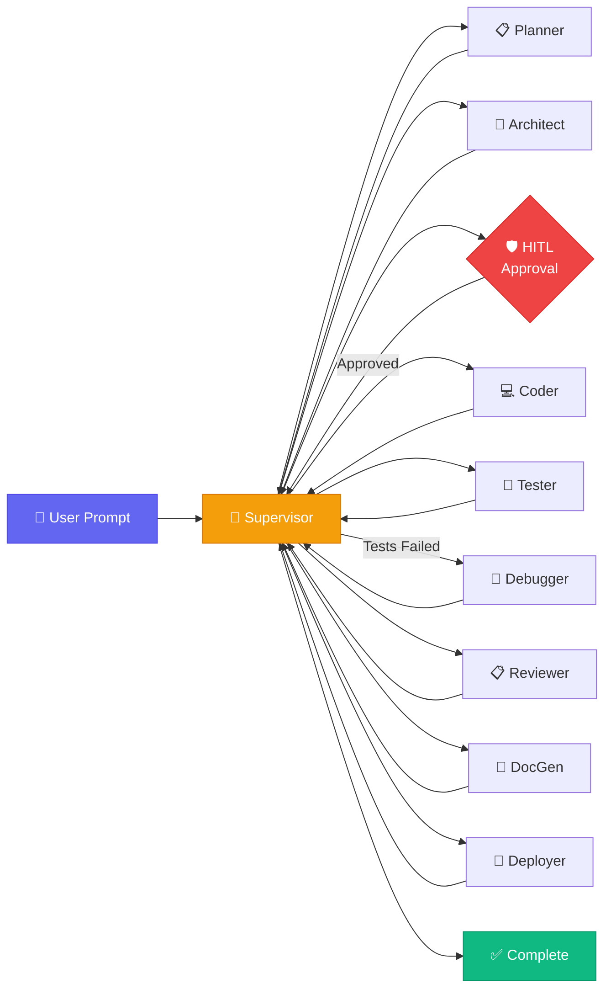

<p align="center">
  
</p>

<h1 align="center">AgentForge</h1>

<p align="center">
  <strong>Autonomous Multi-Agent AI Software Engineering Platform</strong><br/>
  <em>Transform a single-sentence idea into a production-ready, tested, documented, and deployable codebase — powered by 9 specialized AI agents running 100% locally.</em>
</p>

<p align="center">
  <a href="#-quickstart"></a>
  <a href="docs/ARCHITECTURE.md"></a>
  <a href="docs/PHASES.md"></a>
  <a href="CONTRIBUTING.md"></a>
</p>

<p align="center">
  
  
  
  
  
  
  
</p>

---

## 🎬 What is AgentForge?

AgentForge is an **open-source, local-first, multi-agent AI platform** that autonomously generates full-stack software applications from a single natural language prompt. It demonstrates modern AI Engineering concepts including:

| Concept | Implementation |
|:---|:---|
| 🤖 Multi-Agent Orchestration | 9 specialized LangGraph agent nodes with conditional routing |
| 🔄 Self-Healing Code Loop | Tester → Debugger → Tester retry cycle (max 3 iterations) |
| 🧠 RAG & Long-Term Memory | ChromaDB vector store for episodic & semantic code memory |
| 🛡️ Human-in-the-Loop (HITL) | Interactive architecture approval checkpoint before coding |
| 📝 Auto Documentation | README and API docs generated inside output repositories |
| 🐳 DevOps Automation | Dockerfile, docker-compose, and GitHub Actions CI/CD auto-generated |
| 📦 One-Click Export | Download complete generated repository as a ZIP archive |
| ⚡ Real-Time Streaming | Server-Sent Events (SSE) for live agent execution visualization |
| 🔒 100% Local & Private | Runs entirely offline using Ollama — no paid API keys needed |

---

## 🏛️ 9-Node Agent Pipeline Architecture



### Agent Responsibilities

| # | Agent | Role | Key Technology |
|:-:|:---|:---|:---|
| 1 | **Supervisor** | Orchestrates execution routing across all nodes | Deterministic state machine |
| 2 | **Planner** | Decomposes prompt into milestones & tech stack | LLM structured JSON output |
| 3 | **Architect** | Designs file tree & module specs | RAG-augmented (ChromaDB) |
| 4 | **HITL Gate** | Pauses for human approval of architecture | Interactive modal UI |
| 5 | **Coder** | Generates production source code per file | RAG-augmented (ChromaDB) |
| 6 | **Tester** | Runs `py_compile` / `node --check` syntax validation | Subprocess sandboxed execution |
| 7 | **Debugger** | Root cause analysis + surgical code patches | LLM reflection loop (max 3) |
| 8 | **Reviewer** | Code quality, security, completeness audit | 4-metric scorecard |
| 9 | **DocGen** | Generates project README & docs | LLM documentation agent |
| 10 | **Deployer** | Creates Dockerfile, docker-compose, CI/CD | Template-based generation |

---

## 🧰 Tech Stack

| Layer | Technology |
|:---|:---|
| **LLM Provider** | [Ollama](https://ollama.com) (local) — `qwen2.5-coder`, `deepseek-r1`, `llama3.1`, `mistral` |
| **Agent Orchestration** | [LangGraph](https://langchain-ai.github.io/langgraph/) StateGraph |
| **LLM Framework** | [LangChain](https://www.langchain.com/) |
| **Backend** | [FastAPI](https://fastapi.tiangolo.com/) (Python 3.10+) |
| **Frontend** | [React 18](https://react.dev/) + TypeScript + [Vite](https://vite.dev/) + [TailwindCSS](https://tailwindcss.com/) |
| **Vector Database** | [ChromaDB](https://www.trychroma.com/) (persistent, local) |
| **Real-Time Streaming** | Server-Sent Events (SSE) via `sse-starlette` |
| **Containerization** | Docker & Docker Compose |

---

## 🚀 Quickstart

### Prerequisites

| Requirement | Version |
|:---|:---|
| Python | 3.10+ |
| Node.js | 18+ |
| Ollama | Latest ([download](https://ollama.com)) |

### 1. Clone & Setup

```bash
git clone https://github.com/NK0028/agentforge.git
cd agentforge
```

### 2. Pull an Ollama Model

```bash
ollama pull qwen2.5-coder
# OR: ollama pull deepseek-r1 / llama3.1 / mistral
```

### 3. Start Backend

```bash
cd backend
python -m venv venv
source venv/bin/activate        # Windows: venv\Scripts\activate
pip install -r requirements.txt
uvicorn app.main:app --reload --port 8000
```

### 4. Start Frontend

```bash
cd frontend
npm install
npm run dev
```

### 5. Open Dashboard

Navigate to **[http://localhost:5173](http://localhost:5173)** and describe your software idea!

---

## 📁 Project Structure

```
agentforge/
├── backend/
│   ├── app/
│   │   ├── agents/              # 9 LangGraph Agent Nodes
│   │   │   ├── supervisor.py    # Orchestrator & Router
│   │   │   ├── planner.py       # Requirements Decomposition
│   │   │   ├── architect.py     # RAG-Augmented System Design
│   │   │   ├── coder.py         # RAG-Augmented Code Generation
│   │   │   ├── tester.py        # Syntax Validation Engine
│   │   │   ├── debugger.py      # Self-Healing Bug Fixer
│   │   │   ├── reviewer.py      # Code Quality Auditor
│   │   │   ├── docgen.py        # Documentation Generator
│   │   │   └── deployer.py      # DevOps Manifest Creator
│   │   ├── api/
│   │   │   └── agent.py         # REST & SSE Endpoints
│   │   ├── core/
│   │   │   ├── config.py        # Environment Configuration
│   │   │   └── llm.py           # LLM Factory (Ollama)
│   │   ├── graph/
│   │   │   ├── state.py         # AgentState TypedDict
│   │   │   └── workflow.py      # LangGraph DAG Compiler
│   │   ├── services/
│   │   │   ├── workspace.py     # Sandboxed File System
│   │   │   └── memory.py        # ChromaDB RAG Service
│   │   └── main.py              # FastAPI Application Entry
│   └── requirements.txt
├── frontend/
│   ├── src/
│   │   ├── components/
│   │   │   ├── Header.tsx           # Top Navigation & Model Selector
│   │   │   ├── ProjectInput.tsx     # Prompt Input Bar
│   │   │   ├── AgentDAG.tsx         # 9-Node Visual Pipeline
│   │   │   ├── LiveLogs.tsx         # Real-Time Agent Log Stream
│   │   │   ├── CodeViewer.tsx       # Generated File Browser + ZIP Export
│   │   │   ├── TestResultsPanel.tsx # Per-File Test Results
│   │   │   ├── ReviewScoreCard.tsx  # Code Quality Scorecard
│   │   │   ├── MemoryViewer.tsx     # ChromaDB Vector Search UI
│   │   │   └── HITLApprovalModal.tsx # Architecture Approval Modal
│   │   ├── services/api.ts      # Backend API Client
│   │   ├── types/agent.ts       # TypeScript Interfaces
│   │   └── App.tsx              # Main Application
│   └── package.json
├── docs/
│   ├── ARCHITECTURE.md          # System Architecture Deep Dive
│   ├── PHASES.md                # Development Roadmap
│   ├── DEVELOPMENT_LOG.md       # Build Journal
│   ├── PROMPTS.md               # Prompt Engineering Directory
│   ├── DATABASE.md              # State & Persistence Design
│   ├── SECURITY.md              # Sandbox & Security Policies
│   └── ERRORHANDLING.md         # Error Handling Strategies
├── CONTRIBUTING.md
├── docker-compose.yml
└── README.md
```

---

## 🔌 API Reference

### Core Endpoints

| Method | Endpoint | Description |
|:---|:---|:---|
| `POST` | `/api/agent/run` | Start autonomous project generation |
| `GET` | `/api/agent/stream/{id}` | SSE real-time execution event stream |
| `POST` | `/api/agent/resume/{id}` | Resume pipeline after HITL approval |
| `GET` | `/api/agent/workspace/{id}` | List generated workspace files |
| `GET` | `/api/agent/export/{id}` | Download project as ZIP archive |
| `GET` | `/api/agent/memory/stats` | ChromaDB vector memory statistics |
| `GET` | `/api/agent/memory/search?q=...` | Semantic vector similarity search |
| `GET` | `/api/health` | Backend & Ollama health check |
| `GET` | `/api/models` | List available local Ollama models |

### SSE Event Types

| Event | When Emitted | Payload |
|:---|:---|:---|
| `log` | Every agent action | `{ agent, message, timestamp }` |
| `status` | Agent node transitions | `{ current_step, active_agent, file_count, ... }` |
| `file_created` | After Coder/DocGen/Deployer | `{ path, content }` |
| `file_patched` | After Debugger fixes code | `{ path, content }` |
| `test_results` | After Tester completes | `{ overall_passed, passed, failed, file_results }` |
| `review_report` | After Reviewer audit | `{ overall_score, findings, approved }` |
| `awaiting_approval` | HITL checkpoint reached | `{ project_id, architecture }` |
| `complete` | Pipeline finished | `{ project_id, status: "COMPLETED" }` |

---

## 📚 Documentation

| Document | Description |
|:---|:---|
| 📐 [Architecture](docs/ARCHITECTURE.md) | System design, component diagram, state machine flow |
| 🗺️ [Roadmap & Phases](docs/PHASES.md) | Development phases and deliverables checklist |
| 📜 [Development Log](docs/DEVELOPMENT_LOG.md) | Detailed build journal with decisions and rationale |
| 🤖 [Prompt Engineering](docs/PROMPTS.md) | All LLM system & user prompts used by agents |
| 💾 [Database & State](docs/DATABASE.md) | AgentState schema and persistence design |
| 🔒 [Security](docs/SECURITY.md) | Sandbox isolation and security policies |
| 🛠️ [Error Handling](docs/ERRORHANDLING.md) | Error recovery strategies across all agents |

---

## 🤝 Contributing

We welcome contributions! See [CONTRIBUTING.md](CONTRIBUTING.md) for guidelines.

1. Fork the repository
2. Create a feature branch (`git checkout -b feature/amazing-feature`)
3. Commit your changes (`git commit -m 'Add amazing feature'`)
4. Push to branch (`git push origin feature/amazing-feature`)
5. Open a Pull Request

---

## 📄 License

Distributed under the **MIT License**. See `LICENSE` for details.

---

<p align="center">
  Built with ❤️ by <strong>Naeem Khan</strong><br/>
  <em>AI Engineering Student | Open Source Developer</em>
</p>
