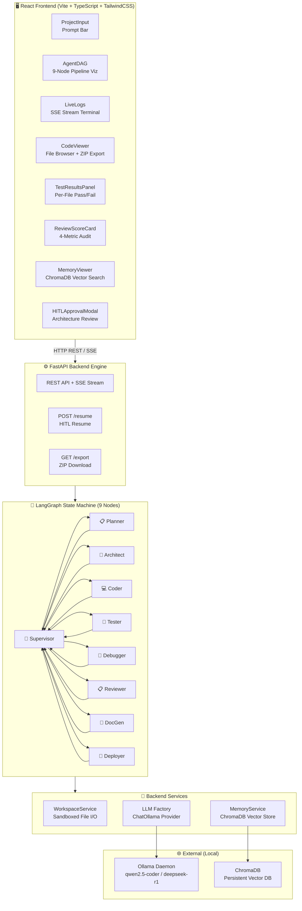
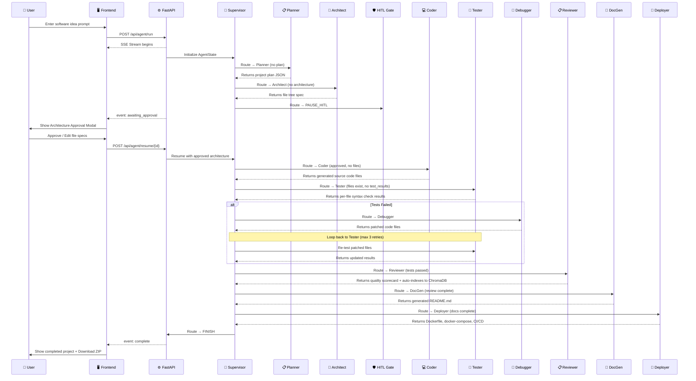
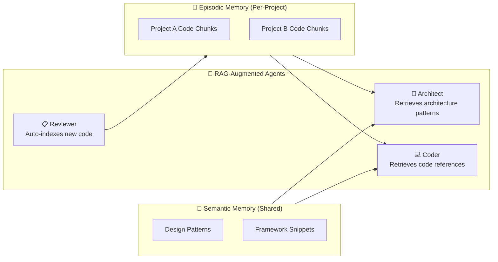
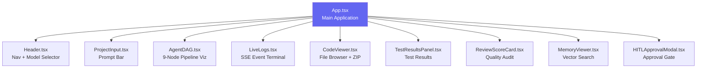

# AgentForge System Architecture 🏗️

AgentForge is built around an **event-driven, local-first, multi-agent orchestration architecture** powered by LangGraph, FastAPI, ChromaDB, and React.

---

## 🏛️ High-Level System Component Diagram



---

## 🔄 Complete 9-Node LangGraph Execution Flow



---

## 📊 AgentState Schema (Shared State Container)

All 9 agent nodes read from and write to a single shared `AgentState` TypedDict:

```python
class AgentState(TypedDict):
    # Identity
    project_id: str
    user_prompt: str
    selected_model: str
    current_step: str
    active_agent: str

    # Phase 1: Core Generation
    plan: Optional[Dict[str, Any]]              # Planner output
    architecture: Optional[Dict[str, Any]]      # Architect output
    generated_files: List[Dict[str, str]]        # Coder output

    # Phase 2: Self-Healing Loop
    test_results: Optional[Dict[str, Any]]       # Tester output
    debug_reflections: List[Dict[str, Any]]      # Debugger patch history
    review_report: Optional[Dict[str, Any]]      # Reviewer scorecard
    retry_count: int                              # Debug retry counter

    # Phase 3: RAG Memory
    rag_context: List[Dict[str, Any]]             # Retrieved memory snippets

    # Phase 4 & 5: HITL & DevOps
    hitl_approved: bool                           # Human approval flag
    awaiting_approval: bool                       # Pipeline paused state
    docs_generated: List[Dict[str, str]]          # DocGen output
    deployment_files: List[Dict[str, str]]        # Deployer output

    # Shared
    logs: List[Dict[str, Any]]                    # Agent execution logs
    next_node: str                                # Supervisor routing decision
    error: Optional[str]                          # Error state
```

---

## ⚡ Server-Sent Events (SSE) Protocol

Real-time streaming between FastAPI and the React frontend uses JSON-formatted SSE events:

| Event | Emitted By | Payload |
|:---|:---|:---|
| `log` | All agents | `{ agent, message, timestamp }` |
| `status` | Supervisor transitions | `{ current_step, active_agent, file_count, retry_count, ... }` |
| `file_created` | Coder, DocGen, Deployer | `{ path, content }` |
| `file_patched` | Debugger | `{ path, content }` |
| `test_results` | Tester | `{ overall_passed, passed, failed, file_results }` |
| `review_report` | Reviewer | `{ overall_score, quality_score, findings, approved }` |
| `awaiting_approval` | HITL Checkpoint | `{ project_id, architecture }` |
| `complete` | Final node | `{ project_id, status: "COMPLETED" }` |
| `error` | Any failure | `{ error, project_id }` |

---

## 🧠 ChromaDB RAG Memory Architecture



- **Episodic Memory**: Per-project code chunks indexed with 20% overlap, stored with `project_id` metadata.
- **Semantic Memory**: Reusable architecture patterns and framework best practices, shared across all projects.
- **Retrieval**: Cosine similarity search via ChromaDB, injected as context into Architect and Coder LLM prompts.
- **Indexing**: Automatically triggered by the Reviewer Agent after code review completion.

---

## 🛡️ Workspace Sandbox Security

- All generated code is written inside `./workspace/<project_id>/` via `WorkspaceService`.
- Path traversal attacks are prevented by sanitizing all file paths before write operations.
- Subprocess execution for testing is time-limited (15s timeout) and restricted to syntax checking only.
- No network access is granted to generated code during testing.

---

## 🔌 Frontend Component Architecture



Each component is self-contained with its own state management and SSE event handlers, communicating through React props and the centralized `App.tsx` state.
