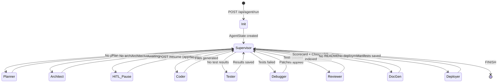

# AgentForge Database & State Persistence 💾

This document describes the state management, persistence, and memory architecture used by AgentForge.

----

## 📊 AgentState: The Core Data Model

AgentForge uses a **shared immutable state container** (`AgentState` TypedDict) that flows through all 9 LangGraph nodes. Each agent reads state, performs work, mutates relevant fields, and returns the updated state back to the Supervisor for re-routing.

```python
class AgentState(TypedDict):
    # Identity & Routing
    project_id: str                              # Unique session identifier
    user_prompt: str                             # Original user input
    selected_model: str                          # Ollama model name
    current_step: str                            # Active pipeline phase
    active_agent: str                            # Currently executing agent
    next_node: str                               # Supervisor routing decision

    # Phase 1: Core Generation
    plan: Optional[Dict[str, Any]]               # Planner JSON output
    architecture: Optional[Dict[str, Any]]       # Architect JSON output
    generated_files: List[Dict[str, str]]         # [{path, content}]

    # Phase 2: Self-Healing
    test_results: Optional[Dict[str, Any]]        # Tester validation results
    debug_reflections: List[Dict[str, Any]]       # Debugger patch history
    review_report: Optional[Dict[str, Any]]       # Reviewer audit scorecard
    retry_count: int                               # Debug retry counter (max 3)

    # Phase 3: RAG Memory
    rag_context: List[Dict[str, Any]]              # ChromaDB retrieval hits

    # Phase 4 & 5: HITL & DevOps
    hitl_approved: bool                            # Human approval flag
    awaiting_approval: bool                        # Pipeline paused state
    docs_generated: List[Dict[str, str]]           # DocGen output files
    deployment_files: List[Dict[str, str]]         # Deployer output files

    # Shared
    logs: List[Dict[str, Any]]                     # Agent execution log
    error: Optional[str]                           # Error state
```

---

## 🗄️ In-Memory State Registry

During execution, project states are stored in two Python dictionaries inside the FastAPI process:

```python
PROJECT_STATES: Dict[str, Dict[str, Any]] = {}     # project_id → AgentState
PROJECT_STREAMS: Dict[str, asyncio.Queue] = {}      # project_id → SSE Queue
```

### Endpoints for State Access

| Endpoint | Returns |
|:---|:---|
| `GET /api/agent/state/{id}` | Current AgentState snapshot |
| `GET /api/agent/workspace/{id}` | Generated files from disk |
| `GET /api/agent/export/{id}` | ZIP archive of workspace |

---

## 🧠 ChromaDB Vector Memory Store

AgentForge uses ChromaDB as a **persistent local vector database** for Retrieval-Augmented Generation (RAG).

### Storage Layout

```
backend/
└── chromadb/                     # Persistent ChromaDB data directory
    └── agentforge_knowledge/     # Single collection, cosine similarity
```

### Memory Types

| Type | Scope | Stored By | Queried By |
|:---|:---|:---|:---|
| **Episodic** | Per-project | Reviewer Agent (auto-index) | Architect, Coder |
| **Semantic** | Cross-project | Manual `store_pattern()` | Architect, Coder |

### Document Schema

Each vector document in ChromaDB carries:

```json
{
  "document": "<code chunk text>",
  "id": "<md5 hash of project:path:chunk_index>",
  "metadata": {
    "project_id": "<project_id or __shared__>",
    "file_path": "<source file path>",
    "chunk_index": 0,
    "memory_type": "episodic | semantic"
  }
}
```

### Code Chunking Strategy

Source code files are split into chunks of **~600 characters** with **20% overlap** to preserve context across chunk boundaries.

### API Endpoints

| Endpoint | Description |
|:---|:---|
| `GET /api/agent/memory/stats` | Returns `{ total_chunks, persist_dir, collection }` |
| `GET /api/agent/memory/search?q=...&n=5` | Semantic similarity search, returns top-K hits |

---

## 📁 Workspace File System

Generated project files are persisted to disk via `WorkspaceService`:

```
backend/workspace/
└── <project_id>/
    ├── main.py
    ├── index.html
    ├── README.md
    ├── Dockerfile
    ├── docker-compose.yml
    └── .github/workflows/ci.yml
```

### Security

- All paths are sanitized to prevent directory traversal.
- Files are only writable inside `workspace/<project_id>/`.
- Read operations are also scoped to the project sandbox.

---

## 🔄 State Lifecycle


