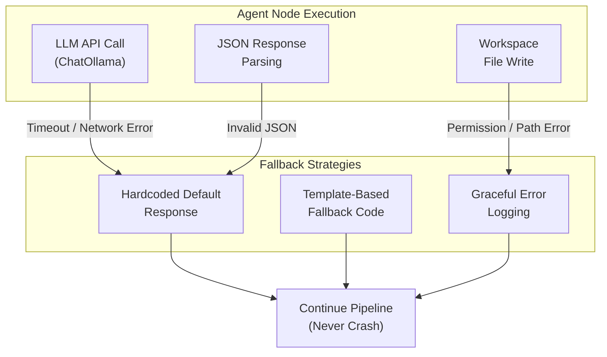

# AgentForge Error Handling & Resilience 🛠️

This document describes the error handling strategies, fallback mechanisms, and resilience patterns used across all 9 agent nodes in AgentForge.

---

## 🏗️ Error Handling Architecture



---

## 📋 Per-Agent Error Handling

### 1. Supervisor Agent
| Error Type | Handling |
|:---|:---|
| State evaluation failure | Falls back to deterministic routing based on field presence checks |
| Unknown `next_node` | Routes to `FINISH` to prevent infinite loops |

### 2. Planner Agent
| Error Type | Handling |
|:---|:---|
| LLM timeout | Returns minimal fallback plan with generic milestones |
| JSON parse failure | Returns hardcoded plan JSON structure |
| Empty response | Logs warning and returns skeleton plan |

### 3. Architect Agent (RAG-Augmented)
| Error Type | Handling |
|:---|:---|
| LLM error | Returns minimal 2-file architecture (`main.py`, `index.html`) |
| ChromaDB retrieval failure | Proceeds without RAG context (logs warning) |
| Invalid architecture JSON | Falls back to default file tree |

### 4. Coder Agent (RAG-Augmented)
| Error Type | Handling |
|:---|:---|
| LLM error per file | Generates placeholder module with purpose comment |
| JSON parse failure | Creates basic Python/JS file with function stub |
| Workspace write failure | Logs error, skips file, continues to next |
| ChromaDB failure | Proceeds without RAG context |

### 5. Tester Agent
| Error Type | Handling |
|:---|:---|
| Subprocess timeout | Marks file as failed with "timed out" stderr |
| Interpreter not found | Marks file as passed with "skipped" note |
| Unknown file type | Marks as passed (non-executable files) |

### 6. Debugger Agent
| Error Type | Handling |
|:---|:---|
| LLM error | Applies comment-only fallback patch with error note |
| Max retries exceeded | Marks `overall_passed = True` to exit loop gracefully |
| JSON parse failure | Uses original code with error comment prepended |

### 7. Reviewer Agent
| Error Type | Handling |
|:---|:---|
| LLM error | Returns default score of 7/10 with "manual review recommended" |
| ChromaDB indexing failure | Logs warning, continues without indexing |
| JSON parse failure | Returns approved status with generic findings |

### 8. DocGen Agent
| Error Type | Handling |
|:---|:---|
| LLM error | Generates minimal README with project name and file list |
| JSON parse failure | Creates markdown from available state data |
| Workspace write failure | Logs error, continues pipeline |

### 9. Deployer Agent
| Error Type | Handling |
|:---|:---|
| Workspace write failure | Logs error, continues pipeline |
| (No LLM calls) | Template-based — no LLM failure modes |

---

## 🔄 Self-Healing Loop Resilience

The Tester → Debugger → Tester retry loop has built-in safeguards:

| Safeguard | Implementation |
|:---|:---|
| **Max retry limit** | `MAX_RETRY_LIMIT = 3` in Debugger Agent |
| **Graceful exit** | After 3 retries, sets `overall_passed = True` to exit loop |
| **Patch history** | All debug reflections stored in `debug_reflections[]` for audit |
| **Retry counter** | Visible in frontend DAG as "🔁 Debug Retry #N" badge |

---

## 🔌 LLM Connection Resilience

### Ollama Import Fallback Chain

The LLM factory (`app/core/llm.py`) handles multiple import paths:

```python
try:
    from langchain_ollama import ChatOllama          # Modern package
except ImportError:
    from langchain_community.chat_models import ChatOllama  # Legacy
```

### Health Check Endpoint

`GET /api/health` proactively checks Ollama daemon availability:
- Verifies TCP connection to `http://localhost:11434`
- Lists available models
- Returns `online: false` if Ollama is unreachable

---

## 📊 Error Visibility

All errors are surfaced through multiple channels:

| Channel | Visibility |
|:---|:---|
| **Agent Logs** | `state["logs"]` entries with error context |
| **SSE Events** | `event: error` streamed to frontend |
| **Backend Logger** | Python `logging.error()` with stack traces |
| **Frontend UI** | Red-highlighted log entries in LiveLogs component |
| **Test Results Panel** | Per-file `stderr` output displayed in UI |

---

## 🎯 Design Principle: Never Crash

AgentForge follows the **"Never Crash"** principle:
- No single agent failure should terminate the entire pipeline.
- Every LLM call is wrapped in `try/except` with a meaningful fallback.
- The Supervisor always has a valid routing path, even in degraded state.
- Frontend displays errors contextually without breaking the UI.
