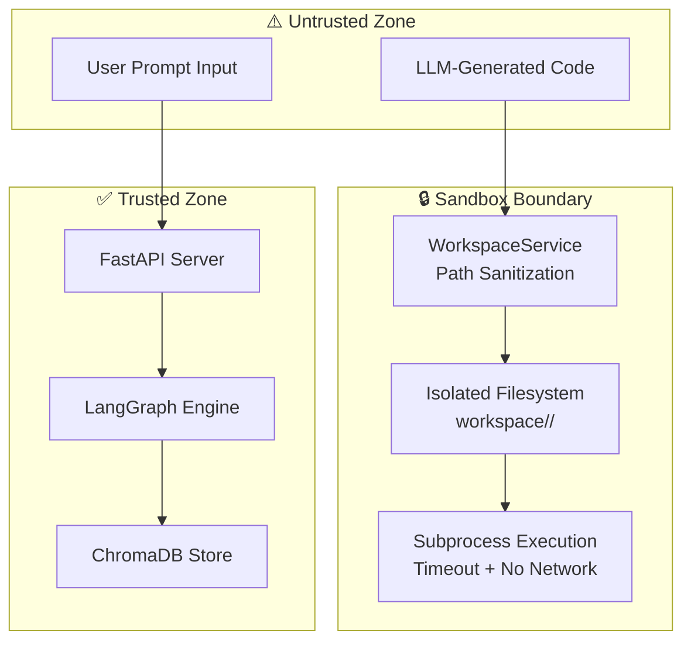

# AgentForge Security & Sandbox Isolation 🔒

This document describes the security architecture, sandbox policies, and threat mitigation strategies implemented in AgentForge.

---

## 🛡️ Security Architecture Overview



---

## 📁 Workspace Sandbox

### Path Traversal Prevention

All file write operations pass through `WorkspaceService`, which:

1. **Strips leading slashes** and `..` sequences from file paths.
2. **Resolves absolute paths** and verifies they remain within `workspace/<project_id>/`.
3. **Rejects paths** that escape the sandbox boundary.

```python
# Simplified sanitization logic
def sanitize_path(self, relative_path: str) -> str:
    clean = relative_path.lstrip("/\\").replace("..", "")
    absolute = os.path.realpath(os.path.join(self.sandbox_path, clean))
    if not absolute.startswith(self.sandbox_path):
        raise ValueError("Path traversal detected!")
    return absolute
```

### File System Isolation

| Property | Value |
|:---|:---|
| Root directory | `backend/workspace/<project_id>/` |
| Write scope | Only inside project sandbox |
| Read scope | Only inside project sandbox |
| Cross-project access | ❌ Blocked |
| System file access | ❌ Blocked |

---

## 🧪 Subprocess Execution Safety

The Tester Agent executes generated code via `subprocess.run()` with strict safety controls:

| Control | Value |
|:---|:---|
| **Timeout** | 15 seconds per file |
| **Network access** | ❌ Not available |
| **Execution scope** | Syntax check only (`py_compile`, `node --check`) |
| **Shell mode** | ❌ Disabled (no shell injection) |
| **Output capture** | `capture_output=True` (stdout/stderr captured, not displayed) |

```python
result = subprocess.run(
    ["python3", "-m", "py_compile", file_path],
    capture_output=True,
    text=True,
    timeout=15  # Hard timeout
)
```

---

## 🔐 LLM Output Sanitization

All LLM responses are treated as **untrusted data**:

1. **JSON parsing** wrapped in `try/except` — malformed responses trigger fallback behavior.
2. **Code content** is written to sandbox only — never executed directly from LLM output.
3. **File paths** from LLM responses are sanitized through `WorkspaceService` before use.
4. **No `eval()` or `exec()`** — LLM output is never dynamically executed in the backend.

---

## 🌐 API Security

| Control | Implementation |
|:---|:---|
| **CORS** | Configured via `CORSMiddleware` with explicit origin allowlists |
| **Input validation** | Pydantic models on all POST request bodies |
| **Rate limiting** | Recommended for production deployment |
| **Authentication** | Not implemented (local-first design) — add for cloud deployment |
| **HTTPS** | Recommended for production — use reverse proxy (nginx/caddy) |

---

## 🧠 ChromaDB Security

| Control | Implementation |
|:---|:---|
| **Telemetry** | Disabled (`anonymized_telemetry=False`) |
| **Data scope** | Local filesystem only (`backend/chromadb/`) |
| **Access** | No network exposure — accessed only via Python API |
| **Data isolation** | Metadata-filtered queries prevent cross-project data leakage |

---

## ⚠️ Known Limitations & Future Hardening

| Area | Current State | Planned Improvement |
|:---|:---|:---|
| Code execution | Syntax check only | Containerized execution (Docker sandbox) |
| Authentication | None (local-only) | JWT/OAuth2 for multi-user deployment |
| Rate limiting | None | FastAPI middleware or API gateway |
| Input length | Unbounded | Max prompt length validation |
| File size | Unbounded | Max file size per workspace |
